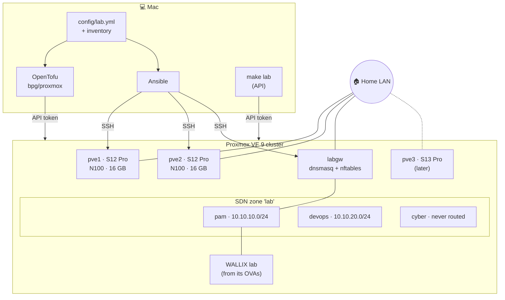

<div align="center">

# 🧪 Lab

**A Proxmox VE homelab, declared as code, for PAM, DevOps and cybersecurity practice.**

Two Beelink Mini S12 Pro nodes now, a Beelink Mini S13 Pro later.
One YAML file describes the lab; OpenTofu and Ansible build it; `make` drives everything from a Mac.

[](https://github.com/morandeirachema/Lab/actions/workflows/check.yml)


</div>

---

## ✨ Highlights

- **One source of truth.** [`config/lab.yml`](config/lab.yml) declares the segments, the gateway and every lab's VMs. [`ansible/inventory/hosts.yml`](ansible/inventory/hosts.yml) holds every address. OpenTofu and Ansible both read them, so nothing is written twice.
- **VirtualBox OVAs in, Proxmox VMs out.** `make unpack` verifies an OVA against its manifest and reads its OVF. Then OpenTofu uploads the disks and builds the VM: SATA disks and an e1000 NIC, the hardware VirtualBox guests already have drivers for.
- **Isolated lab segments across nodes.** An SDN zone (VLAN or VXLAN) with `pam`, `devops` and `cyber` vnets. A tiny gateway container gives them DHCP and DNS and enforces a firewall policy. `cyber` is never routed.
- **Logs and metrics in 4 GB.** WALLIX's audit trail goes over syslog into Loki, and Proxmox's own metrics over OTLP into Prometheus, with Grafana on top. The gateway lets the lab nets reach only the collector's ports.
- **Remote by default.** `make lab` starts, stops, snapshots and rolls back whole labs over the Proxmox API. Tailscale reaches the nodes from anywhere without opening a port.
- **No secrets in git.** The API token lives in `~/.config/lab/` (0600). The Tailscale key is read from the environment. OVAs and disks are git-ignored.
- **Checked, not guessed.** Specs and commands come from Beelink, Intel, Proxmox, Tailscale and provider sources, linked in the docs. Anything unverified (like the S13 Pro's specs) is marked as unverified.
- **CI on every push.** shellcheck, yamllint, Ansible syntax, and `tofu validate` against the provider's real schema, all without touching the cluster.

## 🗺️ Architecture



| Layer | Tool | Owns |
|---|---|---|
| Declaration | YAML | the lab: segments, pools, gateway, guests, addresses |
| Nodes | Ansible `pve_base` | repos, upgrades, ZFS ARC, kernel modules, SSH, routes |
| Cluster prerequisites | Ansible `pve_iac` | `terraform@pve`, its role and API token, `import` storage |
| Proxmox objects | OpenTofu | SDN zone and vnets, pools, gateway container, disk uploads, VMs |
| Inside the gateway | Ansible `lab_gateway` | DHCP/DNS (dnsmasq), routing policy (nftables) |
| Observability | OpenTofu + Ansible `observability` | the `obs` VM: Alloy, Loki, Prometheus, Grafana; Proxmox's metric push |
| Remote access | Ansible `tailscale` | tailnet membership, subnet routes |
| Operations | `scripts/` | OVA unpacking, lab power and snapshots |

## 🚀 Quick start

```sh
brew install ansible opentofu jq shellcheck yamllint
make check                     # validate everything offline
```

Then, for a fresh cluster ([full walkthrough](docs/05-iac-workflow.md)):

```sh
make ping && make nodes        # baseline every node                (docs/03)
#   form the cluster by hand:  pvecm create / pvecm add             (docs/04)
make iac                       # API user, role, token → ~/.config/lab/
make unpack OVA=~/path/to/<wallix-appliance>.ova   # each OVA   (docs/06)
make init && make plan         # read the plan
make apply                     # SDN, pools, gateway, WALLIX VMs
make gateway                   # DHCP + firewall inside the gateway
export GRAFANA_ADMIN_PASSWORD=… && make obs   # logs + metrics + Grafana  (docs/10)
make lab LAB=wallix CMD=start
```

## 🎛️ Day to day

| You want to… | Run |
|---|---|
| See a lab | `make lab LAB=wallix CMD=status` |
| Start / stop it (boot order = VMID order) | `make lab LAB=wallix CMD=start` · `CMD=stop` |
| Save a clean state | `make lab LAB=wallix CMD=snapshot NAME=baseline` |
| Reset after an exercise | `make lab LAB=wallix CMD=rollback NAME=baseline` |
| Add a VM from an OVA | `make unpack OVA=…`, paste the entry into `config/lab.yml`, `make apply` |
| Change anything | edit `config/lab.yml`, then `make plan` and `make apply` |
| Reach it from outside home | `make remote` (Tailscale), see [docs/07](docs/07-remote-management.md) |

## 🧱 Hardware

| Node | Model | CPU | RAM | Network | Status |
|---|---|---|---|---|---|
| `pve1` | Beelink Mini S12 Pro | Intel N100 · 4C/4T | 16 GB (the maximum) | 1 × 1 GbE | ✅ in service |
| `pve2` | Beelink Mini S12 Pro | Intel N100 · 4C/4T | 16 GB (the maximum) | 1 × 1 GbE | ✅ in service |
| `pve3` | Beelink Mini S13 Pro | Intel N150 · 4C/4T | verify on arrival | verify on arrival | 🔜 later |

Around the cluster: a **Synology DS224+** (NFS storage and backups) and a **Mac mini M4 (16 GB)**,
the always-on control node and QDevice host ([docs/09](docs/09-nas-and-control-node.md)).

Beelink and Intel both state 16 GB as the maximum, so the lab is planned within that.
Sources and BIOS settings are in [docs/01](docs/01-hardware.md).

## 🧪 Labs

| Lab | Segment | Guests | Status | Certifications it serves |
|---|---|---|---|---|
| **WALLIX** | `pam` (no internet) | the WALLIX OVAs, imported with `make unpack` | 🟢 in code | WALLIX WCE-P |
| **DevOps** | `devops` (internet) | Kubernetes from cloud images, a Git forge with CI, monitoring | 🟡 planned | CKA, CKS |
| **Cyber range** | `cyber` (never routed) | attacker and vulnerable OVAs | 🟡 planned | CEH, OSCP practice |

Details are in [docs/06](docs/06-wallix-lab.md) and [docs/08](docs/08-roadmap.md).

## 📚 Documentation

| # | Doc | What's inside |
|---|---|---|
| 01 | [Hardware](docs/01-hardware.md) | verified specs, the 16 GB-per-node budget, BIOS settings |
| 02 | [Network](docs/02-network.md) | address plan, VLAN vs VXLAN, gateway policy, reaching the lab from the Mac |
| 03 | [Install](docs/03-install.md) | Proxmox VE on each node, first contact from the Mac |
| 04 | [Cluster](docs/04-cluster.md) | forming it, two-node quorum, adding pve3 |
| 05 | [IaC workflow](docs/05-iac-workflow.md) | what declares what, the order, state and secrets, known limits |
| 06 | [WALLIX lab](docs/06-wallix-lab.md) | from the WALLIX OVAs to a baseline you can reset |
| 07 | [Remote management](docs/07-remote-management.md) | LAN, Tailscale, TLS trust, Wake-on-LAN, hardening |
| 08 | [Roadmap](docs/08-roadmap.md) | phases, mapped to the certification plan |
| 09 | [NAS and control node](docs/09-nas-and-control-node.md) | creating the DS224+ volume, share and NFS rules; backups; the QDevice; the Mac mini as control node |
| 10 | [Observability](docs/10-observability.md) | SIEM-lite in 4 GB: WALLIX syslog and Proxmox metrics into Loki, Prometheus and Grafana |

## 📁 Repository map

```
config/lab.yml            the lab, declared once
ansible/
  inventory/              hosts and addresses (read by OpenTofu too)
  playbooks/              pve-postinstall · pve-iac · lab-gateway · remote-access
  roles/                  pve_base · pve_iac · lab_gateway · tailscale
terraform/                provider · sdn · pools · gateway · vms (bpg/proxmox, locked)
scripts/
  ova-unpack.sh           OVA → verified disks + the lab.yml entry
  lab-ctl.sh              lab power and snapshots over the Proxmox API
docs/                     01–08, read in order the first time
Makefile                  the entry point: `make` lists everything
.github/workflows/        offline checks on every push
```

## 🔎 Status

> [!IMPORTANT]
> **Validated offline, not yet applied to the hardware.** CI passes on every push. Each
> piece has also been exercised without a cluster:
> - the scripts, against stubbed Proxmox APIs, under macOS's bash 3.2;
> - `tofu plan` with no cluster behind it;
> - the gateway templates, rendered for a minimal and a full config.
>
> Expect small fixes on first contact with the real nodes. [docs/05](docs/05-iac-workflow.md#known-limits-of-the-code) lists the known limits.

## 🧭 Principles

1. **Declare, don't click.** If it can be code, it is code. The few manual steps are listed with the reason ([docs/05](docs/05-iac-workflow.md#still-manual-and-why)).
2. **One place per fact.** Values live in `config/lab.yml` or the inventory, nowhere else.
3. **Least surprise for the cluster.** Node changes roll one node at a time, VMs are created stopped, and OpenTofu ignores power state, so `make plan` never shows a running lab as drift to undo.
4. **Isolation first.** Lab nets cannot reach the home LAN, and the cyber range reaches nothing.
5. **Say where facts come from.** Sources are linked; anything unverified says so.
