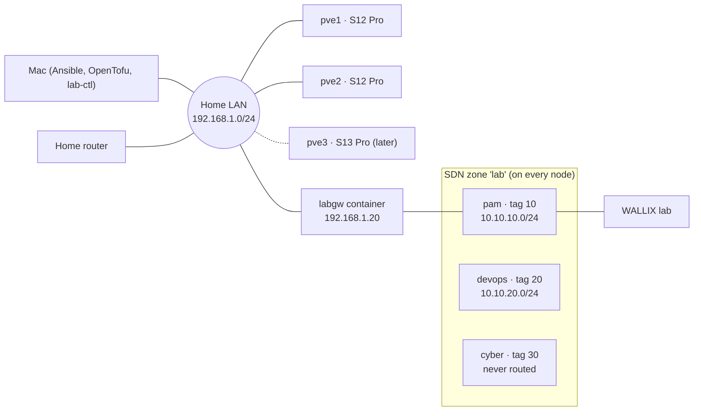

# 2. Network

Everything below is declared in `config/lab.yml` (segments, gateway) and
`ansible/inventory/hosts.yml` (addresses). Change it there, not on the nodes.



## Address plan

All LAN values are placeholders. Use your own subnet, and keep static addresses outside
your router's DHCP pool.

| What | Address | Where it is set |
|---|---|---|
| Home LAN | `192.168.1.0/24`, gateway `192.168.1.1`, DNS = Pi-hole on the NAS `192.168.1.219` | `config/lab.yml` → `lan` |
| `pve1`, `pve2`, `pve3` | `.11`, `.12`, `.13` | `ansible/inventory/hosts.yml` |
| `labgw` (LAN side) | `.20` | `ansible/inventory/hosts.yml` |

| Segment | Tag | Subnet | Gateway / DHCP | Internet | Status |
|---|---|---|---|---|---|
| `pam` | 10 | `10.10.10.0/24` | `.1`, leases `.100–.199` | no | phase 1 |
| `devops` | 20 | `10.10.20.0/24` | add to `gateway.nets` | planned yes | phase 2 |
| `cyber` | 30 | `10.10.30.0/24` | none: the gateway never routes it | never | phase 3 |
| `obs` | 40 | `10.10.40.0/24` | `.1`; the `obs` VM is static at `.10` | yes (packages) | in code ([10](10-observability.md)) |

**VMID ranges.** OpenTofu doesn't enforce these; they are a convention so a VMID tells
you what it is.

| Range | Use |
|---|---|
| 100–199 | infrastructure (110 = `labgw`, 120 = `obs`) |
| 1000–1999 | PAM lab |
| 2000–2999 | DevOps lab |
| 3000–3999 | cyber range |

Within a lab, VMID order is boot order for `scripts/lab-ctl.sh`.

Lab guests get names in `lab.home.arpa`. `home.arpa` is the domain RFC 8375 reserves for
home networks. A guest that sends its hostname in DHCP becomes
`<hostname>.lab.home.arpa`.

## VLAN or VXLAN

The S12 Pro has a single NIC, so every lab segment shares one cable per node. The
`sdn.type` setting in `config/lab.yml` chooses how the segments cross between nodes:

- **`vlan`** (default). Lab traffic is 802.1Q-tagged on `vmbr0`. Every switch between
  the nodes must pass tagged frames. A managed switch does, if the ports are trunks for
  tags 10/20/30. Unmanaged switches and ISP routers vary.
- **`vxlan`**. Lab traffic is tunnelled over UDP between the node addresses, which
  works on any switch. The cost is MTU. In the Proxmox docs' words, "because VXLAN
  encapsulation uses 50 bytes, the MTU needs to be 50 bytes lower than the outgoing
  physical interface". That means 1450 inside the lab. OpenTofu sets the zone and the
  gateway's interfaces to it. A guest NIC is different:
  - virtio NICs can inherit the bridge MTU, and OpenTofu sets that.
  - Emulated NICs (e1000, which imported VirtualBox guests use) cannot. Set 1450 inside
    the guest. The gateway also offers MTU 1450 in DHCP (option 26), but whether a guest
    applies it depends on its DHCP client.

**Test before relying on it.** Put one Linux guest on each node in the same vnet and,
from one of them, ping the other: once with a small packet, once with a full-size one.

```sh
ping -c3 10.10.10.x                 # basic reachability
ping -c3 -M do -s 1472 10.10.10.x   # vlan: works; vxlan: fails unless the guest MTU is 1450 (then use -s 1422)
```

If the small ping fails on `vlan`, your switch drops tags. Fix the switch, or move to
`vxlan`. **Choose the type before the first `make apply`.** The vnets live inside the
zone, and Proxmox will not remove a zone that still has vnets. Switching later means
removing the lab objects first (`cd terraform && tofu destroy`), then changing
`sdn.type` and applying again.

## The gateway's policy

`labgw` is a 256 MB unprivileged container. `eth0` is on the LAN; `eth1…` are on the
vnets, in `gateway.nets` order. It runs dnsmasq (DHCP and DNS) and nftables
(`ansible/roles/lab_gateway`).

| From → to | Verdict |
|---|---|
| LAN (`lan.cidr`, or `gateway.mgmt_cidr`) → any routed lab net | allowed |
| lab net → internet | only if `internet: true`, and never to private ranges |
| lab net → home LAN | dropped |
| lab net → another lab net | dropped |
| any other lab net → `obs` VM | only the collector ports: syslog 514 tcp/udp, OTLP 4318 tcp |
| anything → `cyber` | not routed at all |
| DHCP on the home LAN | never (`no-dhcp-interface=eth0`) |

**What is and isn't confirmed.** Proxmox staff confirm that a container shares the
host's kernel, so its netfilter modules must be loaded on the host. `pve_base` does
that on every node. NAT with nftables *inside an unprivileged container* is reported to
work by the community, but Proxmox doesn't document it. If masquerading fails once
deployed, that is the first suspect.

## Reaching the lab from the Mac

The lab nets sit behind `labgw`, so your Mac needs a route to them. Pick one:

1. **On the home router** (best, if it supports static routes): `10.10.10.0/24` via
   `192.168.1.20`.
2. **On the Mac only, until reboot:**
   ```sh
   sudo route -n add -net 10.10.10.0/24 192.168.1.20
   ```
3. **On the Mac, persistent.** `networksetup` replaces the whole list each time, so
   name every route you want to keep:
   ```sh
   networksetup -setadditionalroutes "Wi-Fi" 10.10.10.0 255.255.255.0 192.168.1.20
   networksetup -getadditionalroutes "Wi-Fi"
   ```

To resolve lab names (`<guest>.lab.home.arpa`) from every device, add one conditional
forwarding entry to Pi-hole, the LAN's DNS on the NAS
([09-nas-and-control-node.md](09-nas-and-control-node.md#5-lab-names-through-pi-hole)).
For a single Mac without touching Pi-hole, a per-domain resolver works too:

```sh
sudo mkdir -p /etc/resolver
echo "nameserver 192.168.1.20" | sudo tee /etc/resolver/lab.home.arpa
```

Guests on `pam` get the gateway as their default route by DHCP, so replies come back
without NAT, and the WALLIX audit trail sees your Mac's real address. Guests with a static IP
and no default route need `gateway.snat_from_lan: true` instead. Then the LAN traffic
they receive appears to come from the gateway.
