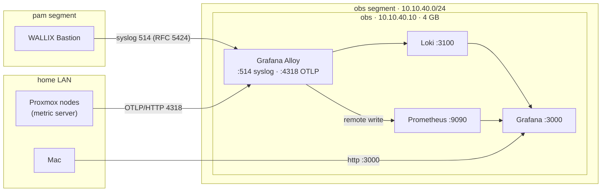

# 10. Observability and SIEM-lite

One 4 GB VM, `obs`, collects the lab's logs and the cluster's metrics:

- **Logs:** WALLIX Bastion audit events, and anything else on the lab nets that speaks syslog.
- **Metrics:** Proxmox's own host, guest and storage metrics.
- **Grafana** on top, for dashboards, search and alert rules.

It's built by `terraform/observability.tf` and configured by
`ansible/roles/observability`.

## Why this stack, within 4 GB

The budget for the whole stack is **4 GB of RAM**. Full SIEMs don't fit, by their vendors'
own published numbers:

| Stack | Vendor figure | Source |
|---|---|---|
| Wazuh all-in-one (1–25 agents) | 4 vCPU, **8 GiB**; the indexer alone needs a 4 GB minimum | [Wazuh quickstart](https://documentation.wazuh.com/current/quickstart.html), [indexer](https://documentation.wazuh.com/current/installation-guide/wazuh-indexer/index.html) |
| Security Onion | Eval **8 GB**, Standalone **24 GB**. "Import" (4 GB) only imports PCAP/EVTX files | [Security Onion hardware](https://docs.securityonion.net/en/2.4/hardware.html) |
| **Grafana** | "Minimum recommended memory: 512 MB" | [Grafana requirements](https://grafana.com/docs/grafana/latest/setup-grafana/installation/) |

So this is a **SIEM-lite**: searchable, labelled logs, alert rules on them, and metrics. It
is not a correlation engine with threat intel. Neither Loki nor Prometheus publishes a RAM
minimum for this size, so **measure**: watch the VM's memory in Grafana or with `free -m`.
A full SIEM (Wazuh) is planned for when pve3 adds capacity ([08](08-roadmap.md)).

## How the data flows



- **The gateway lets the lab nets reach only the collector**: `10.10.40.10` on syslog
  514/tcp+udp and OTLP 4318/tcp, declared in `observability.collector`. Lab nets still can't
  reach each other or the LAN. `cyber` is never routed.
- **Proxmox pushes its metrics** through its built-in *External Metric Server*
  (OpenTelemetry). OpenTofu declares it (`proxmox_metrics_server`), and the nodes reach
  `10.10.40.0/24` through `labgw` (`pve_base` routes every gateway net).
- **Why remote write and not OTLP into Prometheus:** Debian 13's Prometheus (2.53.3) ships
  with its OTLP receiver patched out. Alloy turns OTLP into remote write, which Prometheus
  accepts with `--web.enable-remote-write-receiver`.
- **Retention:** 14 days for both. Prometheus also stops at 10 GB.
- **Security updates:** `obs` and `labgw` install Debian's security updates unattended
  (`debian_autoupdates`). Grafana's repository is not in the unattended origins, so Grafana,
  Loki and Alloy change only when you upgrade them yourself (`apt upgrade` on `obs`).
  `make obs` installs them but never upgrades them.

## Build it

After `make apply` (which creates the VM and the metric server) and `make gateway`:

```sh
make nodes                                  # the nodes' routes to 10.10.40.0/24
export GRAFANA_ADMIN_PASSWORD='…'           # first run only: 12+ chars, letters, digits, _ . : @ + = ! ? , ~ # -
make obs
```

Open **Grafana at `http://obs.lab.home.arpa:3000`** (or `http://10.10.40.10:3000`) from the Mac.
The gateway publishes the `obs` name, and Pi-hole's forwarding entry or the Mac's resolver file
from [02](02-network.md#reaching-the-lab-from-the-mac) sends the query there. That needs the route to
`10.10.40.0/24` via `labgw`, as in [02-network.md](02-network.md#reaching-the-lab-from-the-mac).
Log in as `admin` with that password. Grafana applies it once, at first start. Prometheus
and Loki are already set up as data sources.

## Send WALLIX's logs to it

In the Bastion's web UI, the 12.3.2 Admin Guide has two pages: **System → SIEM integration**
and **System → Syslog**. Point them at:

| Setting | Value |
|---|---|
| Server | `10.10.40.10` |
| Port | `514` |
| Protocol | TCP (or UDP) |
| Format | RFC 5424. WALLIX's own Splunk add-on documents "RFC 5424 or legacy". For legacy, set `observability_syslog_format: rfc3164` |

The Bastion's default route must be the gateway (`10.10.10.1`), as in
[06](06-wallix-lab.md#wallixs-own-requirements).

## Find things

In Grafana, go to **Explore**. Then:

- **Loki: everything the Bastion sent**
  - `{source="syslog", message_hostname="<bastion hostname>"}`. Labels kept: `message_hostname`,
    `message_app_name`, `message_severity`, `message_facility`, `connection_ip_address`.
  - Add a line filter to search, e.g. `{source="syslog"} |= "fail"`.
- **Prometheus:** every attribute Proxmox attaches to its metrics, resource attributes
  included, becomes a label, so the nodes' series stay distinct. Browse the metric list in
  Explore. This repo doesn't list metric names: their exact form comes from Proxmox's exporter
  and hasn't been checked against a running cluster yet.
- **Alert rules:** Grafana → Alerting → New alert rule on a LogQL count, e.g. failed logins
  per five minutes. That's the SIEM-lite part.

## Tested so far

Exercised on macOS with the real binaries, downloaded checksum-verified from their releases
(Alloy 1.20.1, Loki 3.7.8, Prometheus 2.53.3):

- the rendered Alloy config passes `alloy fmt`, and the Loki config passes `-verify-config`;
- RFC 5424 syslog over TCP and UDP arrived in Loki with the labels above;
- OTLP metrics from two hosts arrived in Prometheus as two separate series.

Not yet run on the VM itself.
