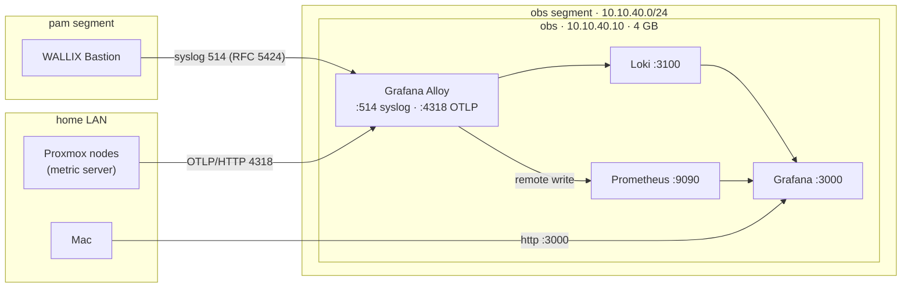

# 10. Observability and SIEM-lite

One 4 GB VM, `obs`, collects the lab's logs and the cluster's metrics:

- **Logs:** WALLIX Bastion audit events, and anything else on the lab nets that speaks syslog.
- **Metrics:** Proxmox's own host, guest and storage metrics.
- **Grafana** on top, for dashboards, search and alert rules.

It's built by `terraform/observability.tf` and configured by
`ansible/roles/observability`.

## Why this stack, within 4 GB

The budget for the whole stack is **4 GB of RAM**. Full SIEMs don't fit, by their vendors'
own published numbers:

| Stack | Vendor figure | Source |
|---|---|---|
| Wazuh all-in-one (1–25 agents) | 4 vCPU, **8 GiB**; the indexer alone needs a 4 GB minimum | [Wazuh quickstart](https://documentation.wazuh.com/current/quickstart.html), [indexer](https://documentation.wazuh.com/current/installation-guide/wazuh-indexer/index.html) |
| Security Onion | Eval **8 GB**, Standalone **24 GB**. "Import" (4 GB) only imports PCAP/EVTX files | [Security Onion hardware](https://docs.securityonion.net/en/2.4/hardware.html) |
| **Grafana** | "Minimum recommended memory: 512 MB" | [Grafana requirements](https://grafana.com/docs/grafana/latest/setup-grafana/installation/) |

So this is a **SIEM-lite**: searchable, labelled logs, alert rules on them, and metrics. It
is not a correlation engine with threat intel. Neither Loki nor Prometheus publishes a RAM
minimum for this size, so **measure**: watch the VM's memory in Grafana or with `free -m`.
A full SIEM (Wazuh) is planned for when pve3 adds capacity ([08](08-roadmap.md)).

## How the data flows



- **The gateway lets the lab nets reach only the collector**: `10.10.40.10` on syslog
  514/tcp+udp and OTLP 4318/tcp (`observability.syslog_port` / `otlp_port`). The Proxmox nodes may
  push metrics whatever `gateway.mgmt_cidr` allows. Lab nets still can't
  reach each other or the LAN. `cyber` is isolated: it reaches the collector only with
  `collector: true` on its net ([02](02-network.md#the-gateways-policy)).
- **Proxmox pushes its metrics** through its built-in *External Metric Server*
  (OpenTelemetry). OpenTofu declares it (`proxmox_metrics_server`), and the nodes reach
  `10.10.40.0/24` through `labgw` (`pve_base` routes every gateway net).
- **Why remote write and not OTLP into Prometheus:** Debian 13's Prometheus (2.53.3) ships
  with its OTLP receiver patched out. Alloy turns OTLP into remote write, which Prometheus
  accepts with `--web.enable-remote-write-receiver`.
- **Retention:** 14 days for both. Prometheus also stops at 10 GB. Loki has no size limit, so a
  guest flooding syslog can fill the 32 GB disk before 14 days pass. That's why a provisioned
  alert, *obs root filesystem low on space*, fires when `/` has less than 15% free for
  10 minutes (`observability_disk_free_min`, `observability_disk_alert_for`). It also fires
  when obs's own host metrics stop arriving. Alloy collects those with
  `prometheus.exporter.unix`.
- **Only the collector is on the network:** Loki and Prometheus listen on `127.0.0.1`. Loki
  runs without auth, with its delete API on, so nothing outside the VM may reach it. Grafana
  (3000) is the only UI port.
- **Security updates:** `obs` and `labgw` install Debian's security updates unattended
  (`debian_autoupdates`). Grafana's repository is not in the unattended origins, so Grafana,
  Loki and Alloy change only when you upgrade them yourself (`apt upgrade` on `obs`).
  `make obs` installs them but never upgrades them.

## Build it

After `make apply` (which creates the VM) and `make gateway`:

```sh
make routes                                 # the nodes' routes to 10.10.40.0/24 (no upgrades)
export GRAFANA_ADMIN_PASSWORD='…'           # first run only: 12+ characters, no spaces
make obs                                    # Alloy, Loki, Prometheus, Grafana
# then set observability.metrics_push: true in config/lab.yml, and:
make apply                                  # Proxmox's metric server, now that Alloy answers
```

The metric server waits for that last step for a reason. Proxmox tests an OpenTelemetry
metric server when it's created: it POSTs to it and refuses the server if nothing answers
(`PVE/Status/OpenTelemetry.pm`, `test_connection`). Alloy only exists after `make obs`.

The Mac needs routes to **both** lab subnets (`10.10.10.0/24` and `10.10.40.0/24`) via `labgw`
for `make obs` and for Grafana ([02](02-network.md#reaching-the-lab-from-the-mac)).

Open **Grafana at `http://obs.lab.home.arpa:3000`** (or `http://10.10.40.10:3000`) from the Mac.
The gateway publishes the `obs` name, and Pi-hole's forwarding entry or the Mac's resolver file
from [02](02-network.md#reaching-the-lab-from-the-mac) sends the query there. That needs the route to
`10.10.40.0/24` via `labgw`, as in [02-network.md](02-network.md#reaching-the-lab-from-the-mac).
Log in as `admin` with that password. It's stored in `/etc/grafana/admin_password`
(root:grafana, 0640), and Grafana reads it through its `$__file{}` provider, not from an
environment variable: systemd warns that unit environment variables are exposed over D-Bus.
Grafana applies it once, at first start. Prometheus
and Loki are already set up as data sources (UIDs `prometheus` and `loki`). The *Lab* folder
holds the *Lab overview* dashboard and the disk alert, all provisioned from the repo.

## Send WALLIX's logs to it

In the Bastion's web UI, the 12.3.2 Admin Guide has two pages: **System → SIEM integration**
and **System → Syslog**. Point them at:

| Setting | Value |
|---|---|
| Server | `10.10.40.10` |
| Port | `514` |
| Protocol | TCP (or UDP) |
| Format | Pick one in WALLIX's SIEM settings (its 12.0.1 release notes mention a log format setting) and make Alloy match: RFC 5424 is the default here (`observability_syslog_format: rfc5424`), legacy BSD syslog is `rfc3164`. The Splunk add-on in the WALLIX GitHub organisation documents "RFC 5424 or legacy" |

The Bastion's default route must be the gateway (`10.10.10.1`), as in
[06](06-wallix-lab.md#wallixs-own-requirements).

## Find things

In Grafana, go to **Explore**. Then:

- **Loki: everything the Bastion sent**
  - `{source="syslog", message_hostname="<bastion hostname>"}`. Labels kept: `message_hostname`,
    `message_app_name`, `message_severity`, `message_facility`, `connection_ip_address`.
  - Add a line filter to search, e.g. `{source="syslog"} |= "fail"`.
- **Prometheus:** every attribute Proxmox attaches to its metrics, resource attributes
  included, becomes a label, so the nodes' series stay distinct. Browse the metric list in
  Explore. This repo doesn't list metric names: their exact form comes from Proxmox's exporter
  and hasn't been checked against a running cluster yet.
- **Alert rules:** Grafana → Alerting → New alert rule on a LogQL count, e.g. failed logins
  per five minutes. That's the SIEM-lite part.

### Keep them as code

Rules, dashboards and data sources are provisioned by `make obs`, so a rebuilt `obs` has
them all.

- **A dashboard:** build it in Grafana, then use *Export → Export as JSON* and save the file
  in `ansible/roles/observability/files/dashboards/`. `make obs` copies every `.json` there to
  `obs`, and deletes ones you removed from the repo. Provisioned dashboards can't be saved
  from the UI (`allowUiUpdates: false`), so the repo stays the source.
- **An alert rule:** add it to `ansible/roles/observability/templates/alerting.yaml.j2`.
  Grafana's *Export* on a rule built in the UI gives the provisioning format
  ([Grafana docs](https://grafana.com/docs/grafana/latest/alerting/set-up/provision-alerting-resources/file-provisioning/)).
- **Notifications:** rules only change state in Grafana until you add a *contact point*.
  Where alerts go (email, a chat webhook) is your choice, and it comes with credentials, so
  it isn't provisioned.

## Tested so far

Exercised on macOS with the real binaries, downloaded checksum-verified from their releases
(Alloy 1.20.1, Loki 3.7.8, Prometheus 2.53.3):

- the rendered Alloy config passes `alloy fmt`, and the Loki config passes `-verify-config`;
- RFC 5424 syslog over TCP and UDP arrived in Loki with the labels above;
- OTLP metrics from two hosts arrived in Prometheus as two separate series.

Grafana 13.2.4 (darwin-arm64, SHA-256-checked), with the role's rendered provisioning files
and Alloy's host metrics feeding Prometheus:

- both data sources came up with their fixed UIDs;
- the alert rule loaded from the file, health `ok`, state inactive at 24.8% free;
- with the threshold set above 100% it went to firing, with its summary;
- the *Lab overview* dashboard landed in the *Lab* folder, and its three queries returned
  data (the disk ratio, syslog lines per host, the log lines with their labels);
- the role's dashboard tasks copied the repo's file and removed a stale one.

Not yet run on the VM itself.
